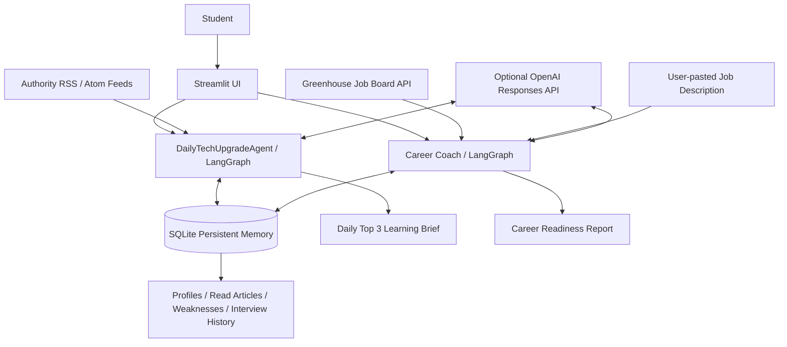
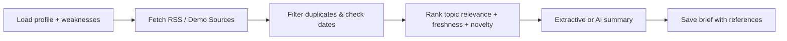
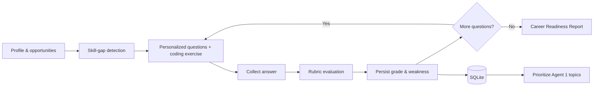

# Architecture and agent goals

## Agent 1 — DailyTechUpgradeAgent

**Goal:** Generate a 15–20 minute learning brief with exactly three dated, source-linked technical articles whenever enough valid source data is available.

**Inputs:** user interests, target roles, previously read URLs, weakness priorities, RSS/Atom entries.

**Tools:** HTTP RSS fetcher; standards-compliant XML parser; relevance ranker; optional OpenAI summary tool; SQLite.

**Long-term memory:** user profile, read URLs, previously saved briefs, skill weaknesses.

**LangGraph nodes:** `load_context → discover → rank → summarize → persist`. Outputs include source, date, URL, excerpt-grounded summary, takeaways, career contribution, and total reading time. A partial brief is reported truthfully when fewer than three sources are found.

## Agent 2 — nextLevelPersonalCoachForCareerLevel

**Goal:** Identify real or user-provided opportunities, compare requirements against a student's skills, conduct interactive assessments, and track progress.

**Inputs:** role targets, user skills, location preferences, Greenhouse public job descriptions or a pasted JD, generated venture hypotheses, interview answers.

**Tools:** Greenhouse public API (jobs/internships/research roles); skill matching; scenario-based venture idea generator (not market validation); technical/coding/founder question selector; optional OpenAI evaluator; keyword-rubric fallback; SQLite.

**Memory:** interview sessions, individual answers, graded topics, skill gaps, recent history.

**LangGraph jobs nodes:** `load → search → match`.

**LangGraph interview nodes:** `validate → evaluate → persist → report`; the `persist` stage generates a targeted follow-up for a weak answer (when there is space before the coding exercise), creating an adaptive branch at the data level.

**Cross-agent collaboration:** if a student performs poorly on a topic, that topic is saved to `weaknesses`. Article scoring adds priority for articles matching these weaknesses. This is persistent across application restarts.

## System architecture

## Agent 1 internal graph

## Agent 2 internal graph

## Important limitations

1. RSS feed availability changes and some sources may fail; live mode never silently substitutes fictional articles.
2. Greenhouse only covers employers using this public job board API; it is not a comprehensive all-jobs search.
3. Job-match scores are simple explainable rankings, not predicted hiring probability. The venture ideas are **hypotheses** that require customer interviews, not proof of market demand.
4. Extractive summaries only reflect RSS excerpts; they are not complete critiques of full papers.
5. Demo interview scoring is keyword coverage, not semantic correctness. When an OpenAI key is provided, an LLM applies an explicit rubric, but human evaluation remains necessary.
6. No user code is executed inside the web app. Coding exercises are reviewed textually.
7. SQLite provides durable long-term memory. The dependency-light fallback graph is only for offline smoke tests; install requirements to use true LangGraph orchestration.
